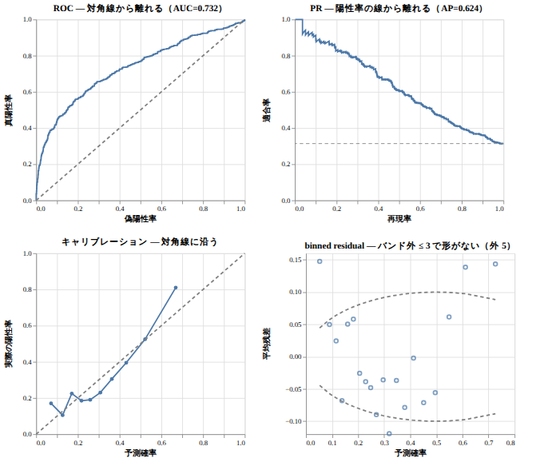
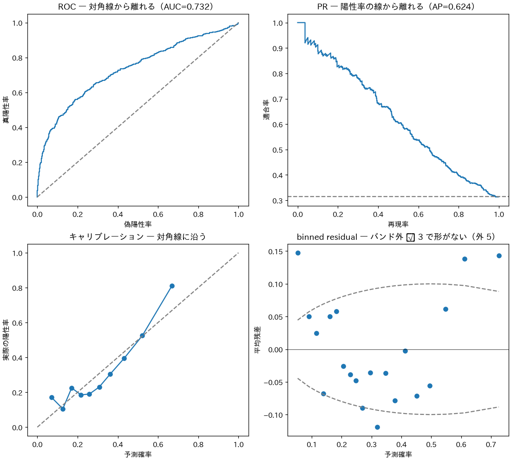
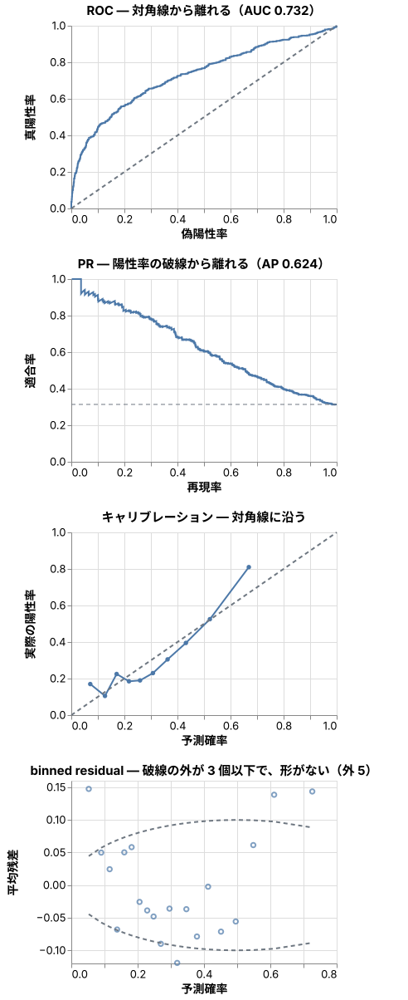

# Data figures: draw them in Python, or in JS / TS

English | [日本語](README.ja.md)

For: someone who uses explainer to explain a model's diagnostics or a distribution of numbers with figures.
It assumes you know when to use Mermaid, D2 and SVG (`docs/figure-cheatsheet/`), and covers data figures only.

What this document says: for a data figure, **compute in JS when JS can, in Python when it cannot, and draw with Vega-Lite**. Then the figure checks work.

The sample script prints Japanese and the figure's labels are Japanese. The quoted output and the figures are kept as they ran (`一致` means "match"); the text around them says what they show.

| Section | Role | What it shows |
|---|---|---|
| 1 | What changes | The conclusion, and where the table of choices is |
| 2 | Evidence: the same computation in both | The diagnostics of a logistic regression, compared |
| 3 | Evidence: do the checks reach the figure | The SVGs of matplotlib and Vega-Lite, run through figure-check |
| 4 | The shape of a diagnostic figure and a verdict table | A figure of four panels, and the table |

## 1. The conclusion

- Draw with a Vega-Lite spec (`figures/<name>.vl.json`). `figure-check.mjs` renders and checks it as it is.
- Computation: aggregation, ROC / PR, calibration, and a GLM's coefficients and SEs can be written in JS. Mixed effects, Cox, robust SEs, factor analysis and SHAP need Python (statsmodels, lifelines and the like).
- If you draw with matplotlib, do not turn the SVG's text into outlines (`svg.fonttype = "none"`). With the default, not one text check works.

The table of choices is under `データの図` (data figures) in `skills/explainer/references/figures.md`.

## 2. The same computation in both: equal to six decimal places

A logistic regression was fitted to 2000 rows (`samples/data.csv`), and its diagnostics were computed in Python and in JS.
The data was made so that the true model has an x1² term, and the fit has linear terms only. There is one misfit the diagnostics should find.

- Python: statsmodels' GLM and scikit-learn (`samples/glm.py`; the values are in `samples/glm.py.json`)
- JS: IRLS written with `ml-matrix`; ROC, PR, calibration and the binned residual written by hand (`samples/glm.mjs`)
- The cross-validation folds were made by Python and stored in the `fold` column of `data.csv`. JS uses the same folds.

<!-- output: glm -->
```
b0          -0.910571  python  -0.910571  一致
b1           0.772060  python   0.772060  一致
b2          -0.560118  python  -0.560118  一致
se_b1        0.058105  python   0.058105  一致
auc          0.732040  python   0.732040  一致
ap           0.623659  python   0.623659  一致
brier        0.178981  python   0.178981  一致
rate         0.314000  python   0.314000  一致
binned_out   5.000000  python   5.000000  一致
```

The JS version finishes in under a second (no browser).

## 3. Do the checks reach it: matplotlib's default SVG walks past every text check

The same four panels were drawn with matplotlib (2 × 2) and with Vega-Lite, and run through `figure-check.mjs`.

| Drawn with | Texts found | Result |
|---|---|---|
| matplotlib, default SVG | 0 | The text becomes paths, so neither overlap nor size can be measured. It now fails with "drawn as outlines" |
| matplotlib, `svg.fonttype = "none"` | 63 | Tick labels are 6px at phone width (two columns). Fails |
| Vega-Lite, 2 × 2 | 78 | Tick labels are 5px at phone width. Fails |
| Vega-Lite, four rows (the figure below) | 78 | Passes |

The 2 × 2 at phone width (tick labels at 5px):



In matplotlib's PNG, the `≤` of a title became tofu (□): the Japanese font (IPAexGothic) has no glyph for it.


`savefig` only warns `Glyph 8804 ... missing`; the figure is saved as it is.
Tofu in a figure drawn by a browser is found by `figure-check.mjs` as "no glyph".

## 4. The diagnostic figure and the verdict table

A panel's title says "what this figure looks at — what must be seen for a pass", and the line of the pass criterion is dashed.



| Diagnostic | Measured | Pass criterion | Verdict | Next action |
|---|---|---|---|---|
| AUC / AP (positive rate 0.314) | 0.732 / 0.624 | Depends on the context. Report them side by side | Check | Decide the level the use needs |
| Brier | 0.179 | Smaller than the baseline 0.314 × 0.686 = 0.215 | OK | — |
| Calibration | figure | Along the diagonal | Check | Above a predicted probability of 0.6, the actual positive rate is higher than predicted |
| Binned residuals outside the band | 5 / 20 bins | 3 or fewer, and no shape | Act | There is a U shape. Add a non-linear term in x1 (x1² or a spline) and fit again |

The verdicts and the next actions were written by looking at the figure and the criteria. The script only gives values; it does not judge.
This shape follows the thinking of the diagnostics skill in [atsushi-green/ds-ai-coding-skills](https://github.com/atsushi-green/ds-ai-coding-skills) (it states no license, so none of its text or code is used).

## Rebuild

```sh
node samples/glm.mjs --write                                        # write the spec again
node ../../skills/explainer/scripts/verify-doc.mjs . --write        # draw the SVG again and check
(cd samples && uv run --with numpy,polars,statsmodels,scikit-learn python glm.py)   # the Python reference values (optional)
```
