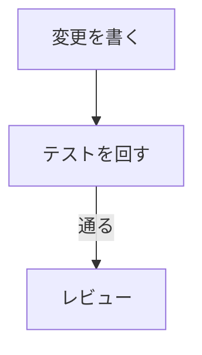
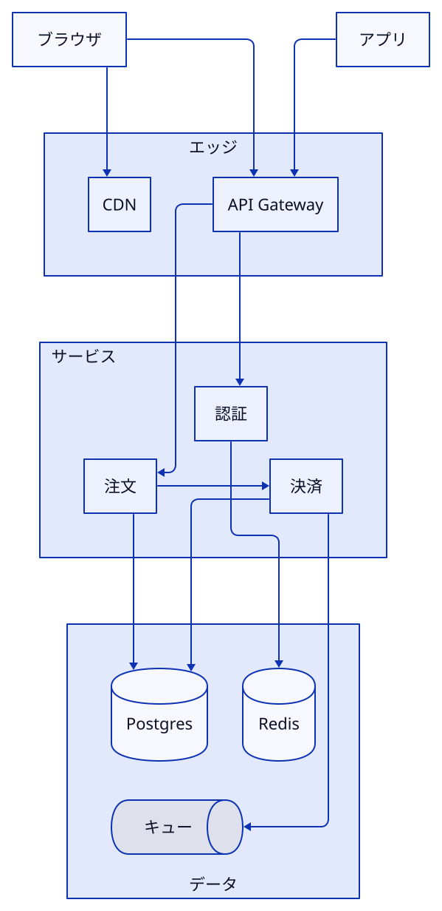
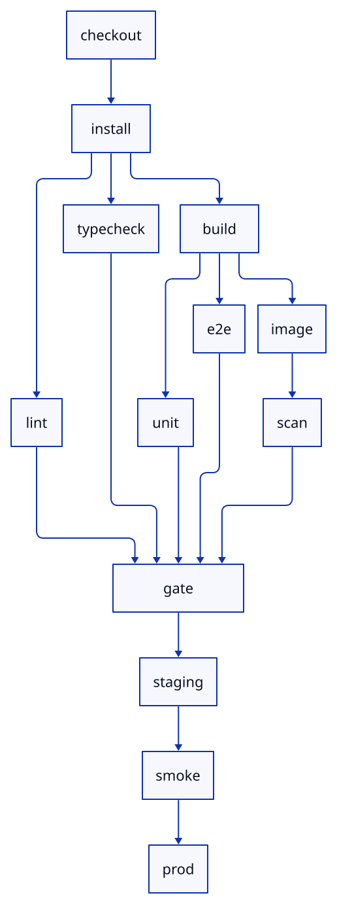
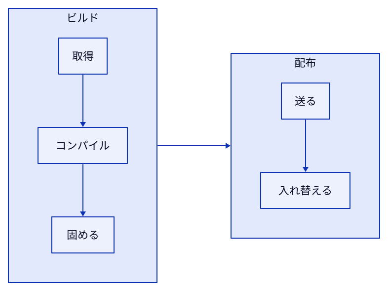
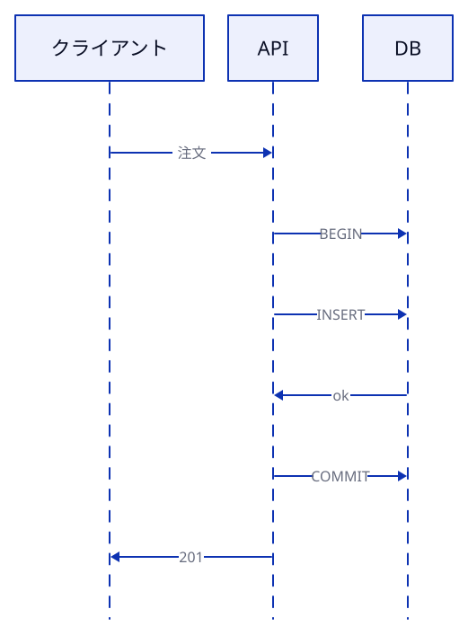
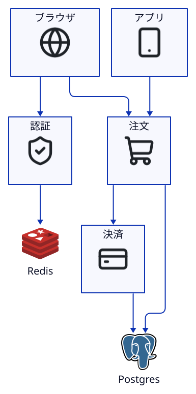
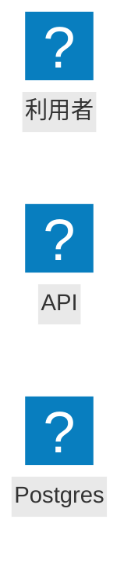

# Which figure, with which tool: Mermaid, D2 (TALA / ELK / dagre), SVG, HTML

English | [日本語](README.ja.md)

> **For**: someone who has an agent write figures in Mermaid, D2 and SVG, and picks between them by feel.
> No introduction to the syntax of Mermaid or D2.
> Two things are covered: which tool and engine for which question, and the failures that really happened with each.
> About 10 minutes.
> The comparison of tools and engines is the output of `samples/compare.mjs`: the same samples drawn with Mermaid and with D2's three engines. Every figure went through `figure-check.mjs`, and every sheet it made was read by eye.
> The output quoted here is run again and compared by `verify-doc.mjs` (from the repository's root: `node skills/explainer/scripts/verify-doc.mjs docs/figure-cheatsheet`).
> D2 is v0.9.0 (the release where TALA became MPL-2.0 and bundled: [d2lang.com/blog/tala-is-open-source](https://d2lang.com/blog/tala-is-open-source/)). Mermaid is 12.0.0.

The samples' labels and the scripts' output are Japanese, and the measurements depend on those labels' widths. So the quoted output and the figures are kept as they ran; the text after each block says what it shows. The words that recur:

| In the output | Means |
|---|---|
| `描ける` | it renders |
| `中が縦に並んだ` / `中も横に並んだ` | the inside came out vertical / the inside came out horizontal too |
| `一番上` / `一番左` | topmost / leftmost |
| `ほぼ動かない`, `少し動く`, `大きく動く` | hardly moves, moves a little, moves a lot |
| `急に伸びる` / `ほぼ伸びない` | grows steeply / hardly grows |
| `減点`, `矢印` | penalty, arrow score |
| `重なって走る` | run on top of each other |
| labels `エッジ`, `サービス`, `データ`, `アプリ`, `キュー` | Edge, Services, Data, App, Queue |
| labels `固める`, `送る`, `通知`, `管理画面` | Bundle, Send, Notifications, Admin |

---

## 0. On one page: try Mermaid, then D2, then SVG / HTML

| Order | Question | Tool | What decides it |
|---|---|---|---|
| 1 | Can Mermaid say it, and does it hold when drawn (a flow, a sequence, a state machine and the like)? | **Mermaid** | GitHub's Markdown (a PR's body, an issue, a README) draws it as a figure. No build, and the reader can fix it |
| 2 | Is it a structure Mermaid falls short of (the four below)? | **D2** | Still a figure of boxes and lines, with the layout decided in detail |
| 3 | Is it a free figure that does not fit D2's boxes and lines? | **SVG / HTML** | SVG when position itself means something; HTML when it is mostly text and code |

Mermaid falls short, and D2 is worth a thought, in one of these cases (measured in section 1).

- You want another direction inside a box (a subgraph), and a box inside it is connected to the outside. Mermaid ignored the inner direction without an error.
- A line runs over a box's name. It happened in Mermaid, and in D2's ELK and dagre. D2's TALA avoided it.
- You want some boxes at fixed positions, or one box near another (`top` / `left` and `near` in D2's TALA).
- There are many boxes and you want to choose the engine that lays them out (section 2).

With D2, choose the engine like this.

| Figure | Engine | What decides it |
|---|---|---|
| A long DAG flowing one way, steps with an edge going back, a large figure drawn again and again | **ELK** | It stacks layers. The entry comes first. Fast. Adding one thing moves the layout little |
| Nested boxes (architecture). A direction per box, some positions fixed, a box near another | **TALA** | Only TALA does the last three. It does not run a line over a box's name |

In these samples dagre never did better than ELK.
It draws the same features, at about the same speed, and makes the same failure of running a line over a box's name.

**When a figure copies a tool's output** (TLC's state graph, the steps of a counterexample, an import graph), the format is chosen in the same order.
The difference: the `.mmd` / `.d2` and the fact sheet (`*.facts.json`) are not written by hand but made from the tool's output by a script (for example `tlc-to-mermaid.mjs`).
`figure-check.mjs` checks that the fact sheet's `edges` and the source's edges are exactly the same.

---

## 1. Is Mermaid enough: what was measured

The same structures as the D2 samples were written as Mermaid flowcharts and run through `figure-check.mjs`.

<!-- output: compare -->
```
mermaid（同じサンプルを Mermaid の flowchart で）
  arch     check ✗ through（light, mobile） "データ" / tiny（mobile） "サービス" 9.0px, "Postgres" 9.0px, "Redis" 9.0px
  pipeline check ✗ tiny（mobile） "checkout" 3.0px, "install" 3.0px, "lint" 3.0px
  loop     check ✓ 0
  サブグラフ同士を辺でつなぐ：✓ サブグラフの中が縦に並んだ（direction TB が効いた）
  中の箱同士をサブグラフをまたいでつなぐ：✗ サブグラフの中も横に並んだ（direction TB が無視された）
```

- **Steps with an edge going back (loop) were fine in Mermaid.** The check's ✗ count is 0 (figure 0 below). A figure like this is Mermaid's.
- **The direction inside a subgraph is ignored once a box inside is connected to the outside** (the last two lines: subgraphs connected to each other kept `direction TB`; boxes connected across subgraphs lost it). With an edge from `固める` inside the build subgraph to `送る` inside the distribution subgraph, the subgraph that says `direction TB` also came out as one row. No error.
  With the same connection, D2's TALA kept the inside vertical (below).
- **In the architecture figure a line ran over the subgraph's name `データ`** (`through`). The same failure as D2's ELK and dagre. It did not happen with TALA (`check` in section 2).
- A DAG that is long sideways came out at 3px on a phone in Mermaid too (`tiny`). As with D2, let it flow downwards.

<!-- output: compare -->
```
  tala  中の箱同士を箱をまたいでつなぐ（固める -> 送る）と ✓ 中が縦に並んだ
```

GitHub's Markdown draws a Mermaid code block as a figure ([GitHub Docs: Creating diagrams](https://docs.github.com/en/get-started/writing-on-github/working-with-advanced-formatting/creating-diagrams)).
For a figure in a PR's description, Mermaid is the cheapest when it is enough.
In this repository's documents, `figure-check.mjs --write` turns `figures/<name>.mmd` into `<name>.svg`, and the Markdown refers to that SVG.

---

## 2. D2's engines: what was measured

The five D2 files in `samples/` were drawn with the three engines and compared.

### What can be drawn

<!-- output: compare -->
```
support（描けるか）
  固定位置（top / left） tala  ✓ 描ける
  固定位置（top / left） elk   ✗ Object "client" has attribute "top" and/or "left" set, but layout engine "elk" does not support locked positions.
  near: 別の箱      tala  ✓ 描ける
  near: 別の箱      elk   ✗ Object "note" has "near" set to another object, but layout engine "elk" only supports constant values for "near".

nested（箱ごとの direction: down が守られたか）
  tala  ✓ 中が縦に並んだ
  elk   ✗ 中も横に並んだ（外の direction: right に従った）
  dagre ✗ 中も横に並んだ（外の direction: right に従った）
  elk   grid-columns: 1 に替えると ✓ 中が縦に並んだ
```

Fixed positions and `near` another box are errors in ELK and dagre. You notice.

**A direction per box is not an error.** ELK and dagre ignore the inner `direction: down` without an error and lay the inside out in the outer direction (`nested`).
`d2 validate` passes too, so you do not notice until you look at the figure.
To get a vertical inside while staying on ELK, write `grid-columns: 1` in place of `direction: down` (the last line).

### The failures that happened

<!-- output: compare -->
```
entry（入口が流れの先頭に来たか）
  loop     tala  ✓ start が一番上
  pipeline elk   ✓ checkout が一番左
  arch     tala  ✗ 一番上は data.pg（入口 browser ではない）
  arch     elk   ✓ browser が一番上

check（figure-check の ✗）
  arch     tala  ✗ tiny（mobile） "アプリ" 9.0px, "キュー" 9.0px
  arch     elk   ✗ through（light, mobile） "エッジ", "サービス", "データ"
  arch     dagre ✗ through（light, mobile） "エッジ", "データ"
  pipeline tala  ✗ tiny（mobile） "checkout" 4.0px, "install" 4.0px, "lint" 4.0px
  pipeline elk   ✗ tiny（mobile） "checkout" 5.0px, "install" 5.0px, "lint" 5.0px
```

- **Without a direction, TALA may not put the entry at the top** (`entry`: whether the entry came first in the flow). In the architecture figure the data layer came out on top and the browser at the bottom. Write `direction: down` when the flow is to be read from the top.
- **ELK and dagre run lines over the boxes' names** (`エッジ`, `サービス`, `データ`). A line crossing boxes cuts through the name at the middle of the top edge. It did not happen with TALA.
- **A DAG that is long sideways cannot be read on a phone, whatever the engine.** A CI pipeline of 16 edges drawn with `direction: right` had 4 to 5px text at 375px wide. Flowing downwards, it passes (figure 2 in section 3).

### What moves when something is added, and the seed

<!-- output: compare -->
```
stable（arch に 1 つ足したとき、元の箱が動いた距離 / 図の対角線）
  tala  箱を 1 つ（通知） 少し動く / 外に箱を 1 つ（管理画面） 大きく動く / 線を 1 本 少し動く
  elk   箱を 1 つ（通知） 少し動く / 外に箱を 1 つ（管理画面） 少し動く / 線を 1 本 ほぼ動かない
  dagre 箱を 1 つ（通知） 少し動く / 外に箱を 1 つ（管理画面） ほぼ動かない / 線を 1 本 ほぼ動かない

seeds（TALA）
  同じ入力・既定の seed で 2 回：同じ SVG
  seed を 1 つずつ 1〜9 に変える：9 通りの配置
  ファイルの vars に tala-seeds: [5]：✗ "tala-seeds" needs a value
```

`stable` is how far the original boxes moved, against the figure's diagonal, when one thing was added to the architecture figure: a box inside, a box outside, a line. `seeds`: the same input and the default seed twice gave the same SVG; seeds 1 to 9 gave nine layouts; a seed in the file's `vars` is refused.

- With the same input and the same seed, TALA gives the same figure every time.
- Change the seed and the whole layout changes (nine seeds, nine layouts). Adding one thing also moves a lot. It is the weakness the official article names.
- For a figure whose diff is read in review, or one that grows a little at a time, ELK suits better.
- **A layout you do not like is chosen again by changing the seed.** With the default seed, figure 1's two lines from the browser split at one point and looked like an arrow between the CDN and the API Gateway. It was first found by eye; seeds 4 to 9 were laid side by side and 5 was chosen.
  This kind of failure is now caught by `figure-check.mjs`'s arrow check (arrows). How to lay the candidates out is in section 4.
- In v0.9.0 the seed cannot be written in the file's `vars` (`needs a value` above). In this repository the file carries a line `# d2-flags: --tala-seeds=5`, and `figure-check.mjs` passes it to d2.

### Speed

<!-- output: compare -->
```
time（描画時間の倍率。箱 10 個のときを 1 とする）
  tala  急に伸びる（40 個で 8 倍以上）
  elk   ほぼ伸びない（40 個で 3 倍未満）
  dagre ほぼ伸びない（40 個で 3 倍未満）
  箱 40 個で TALA は ELK の 10 倍以上
```

`time` is the rendering time as a multiple of the time for 10 boxes: at 40 boxes TALA takes 8 times or more, ELK and dagre under 3 times, and TALA is 10 times ELK or more.

For reference, three runs in this environment gave 4 to 5 seconds for TALA at 40 boxes and under 0.1 second for ELK (measured times change with the environment, so `verify-doc` does not check these).
If an agent runs a loop of drawing again, a figure with more than a few dozen boxes goes to ELK.

---

## 3. Samples

### Figure 0: steps with an edge going back (Mermaid is enough)



<!-- source: figures/loop.mmd -->


No nested boxes and no layout to specify, so Mermaid is enough.

### Figure 1: architecture (TALA)



<!-- source: figures/arch.d2 -->
```d2
# d2-flags: --tala-seeds=5
direction: down
```

TALA was chosen because the boxes are nested and the direction of the flow is not obvious.
`direction: down` is there to put the entry at the top.

### Figure 2: a long DAG (ELK, flowing downwards)



<!-- source: figures/pipeline.d2 -->
```d2
vars: {
  d2-config: {
    layout-engine: elk
  }
}
direction: down
```

ELK lines the branches up in one layer and gathers the join in one place (gate).
Flowing sideways crushes the text on a phone, so it flows downwards.

### Figure 3: a direction per box (TALA)



The same file drawn with ELK has the inside of the boxes in one row too (`nested` in section 2).

### Figure 4: order in time (sequence_diagram)



When a tool can give the order, as with a TLC counterexample, the figure and the fact sheet are made from that output and compared.
For an order that only illustrates and has no tool output behind it, this one written by hand is enough.

### Figure 5: architecture with icons (D2 + ELK)



<!-- source: figures/arch-icons.d2 -->
```d2
auth: 認証 {icon: ./icons/shield-check.svg}
order: 注文 {icon: ./icons/shopping-cart.svg}
pay: 決済 {icon: ./icons/credit-card.svg}
pg: Postgres {shape: image; icon: ./icons/postgresql.svg; width: 72; height: 72}
```

The icons were placed with commands like `icons.mjs add lucide:shopping-cart`. Their sources and licenses are in `figures/icons/ICONS.md`.
Line icons (lucide) go inside boxes; a logo (logos) stands for the product itself.
The logos have their size set with `shape: image`. Without it, the logo was the largest thing in the figure.

### Figure 6: a flow with icons (Mermaid)



<!-- source: figures/flow-icons.mmd -->


In Mermaid an icon is written as `<set>:<name>`. `figure-check.mjs` registers the icon sets installed in the project with Mermaid and draws.
The Mermaid that GitHub's Markdown draws does not have these icon sets. For a PR's body, use no icons, or attach the SVG.

---

## 4. What to check first, format by format

| Tool | What to check first | How |
|---|---|---|
| Mermaid | Does the direction inside a subgraph hold? Does a line run over a subgraph's name? | Look at the figure. `through` in `figure-check.mjs` |
| A figure copying a tool's output (any format) | Does the figure agree with the tool's output? | Make the fact sheet from the tool; facts in `figure-check.mjs` (`edges` exactly equal to the source's edges) |
| D2 + TALA | Is the entry at the top? Does the point where lines split look like another arrow? | Write `direction`. arrows (shared) in `figure-check.mjs`. If it fails, lay seeds side by side with `figure-variants.mjs` |
| D2 + ELK / dagre | Does a line run over a box's name? Did you write a direction per box? | `through` in `figure-check.mjs`. For the direction, look at the figure |
| D2 (any engine) | Is the text 9px or more at phone width? | `tiny` in `figure-check.mjs`. A long flow goes downwards |
| SVG / HTML | Can things be told apart in dark? Does it fall to one column on a phone? | The sheet of `figure-check.mjs` (light, dark, phone) |

### D2 and Mermaid: draw, look, and choose the layout again

What you write in D2 and Mermaid is the meaning only (boxes and edges). The tool decides the layout.
With the meaning right, the drawing can still come out as an unnatural layout, or as arrows that cannot be read from where to where.
So do these three every time you draw.

1. Run `figure-check.mjs`. The arrow check (arrows) fails two edges that run on top of each other for long, and an edge that goes through a box it has nothing to do with.
2. Look at two images: the sheet of the whole figure (light, dark, phone), and the sheet of edges, with one arrow at a time in red. On the edge sheet, check that the red line alone reads as "from where, to where".
3. If the layout is unnatural, lay candidates side by side with `figure-variants.mjs`, look at the scores, and choose by eye.

The version of figure 1 drawn with the default seed (`tests/figure-check/fixtures/arrows-shared.d2`) fails step 1 like this (the two edges from the browser run on top of each other for 222px, and the point where they split looks like an arrow between two other boxes).

<!-- output: arrows-shared -->
```
  ✗ arrows: browser->edge.cdn と browser->edge.gw が 222px 重なって走る。分かれ目が、別の箱同士をつなぐ矢印に見える
```

Laying the candidates out in step 3 gives this order.

<!-- output: arrows-variants -->
```
  #1 TALA seed 6                減点  0  矢印  1  △ 1
  #2 TALA seed 5                減点  0  矢印  2  △ 1
  #3 ELK                        減点  2  矢印  0  △ 0   light: a line runs through 3 label(s): "エッジ", "サービス", "データ"
  #5 TALA seed 1                減点  3  矢印 10  △ 0   arrows: browser->edge.cdn と browser->edge.gw が 222px 重なって走る。
```

- The penalty (`減点`) is the ✗ marks, weighted and summed. Crushed text and two overlapping edges weigh more. The arrow score (`矢印`) counts crossings and detours. For both, smaller is better.
- The machine's ranking is there to drop the clearly bad candidates. Seeds 6 and 5 both have no ✗, and differ by one crossing. Figure 1 stays at 5, as chosen by eye.
- If every candidate keeps a ✗, choosing the layout again will not fix it. Change the figure's structure (how the boxes are divided, the direction, the length of the labels), or move from Mermaid to D2.

The whole procedure is under `手で描く図` (figures drawn by hand) in `skills/explainer/references/figures.md`.

---

## Check your understanding

1. You want only the inside of the services box to be vertical. You wrote `direction: down` with ELK, and it came out as one row with no error. What happened, and what do you do?

<details><summary>Answer</summary>

ELK and dagre ignore a `direction` per box without an error and lay the inside out in the outer direction.
Only TALA can change the direction per box.
Switch to TALA, or stay on ELK and write `grid-columns: 1` inside the box (`nested` in section 2: it came out vertical on ELK too).

</details>

2. You want an agent to draw a module dependency figure of 60 boxes again and again. Which engine?

<details><summary>Answer</summary>

ELK.
TALA's rendering time grows steeply with the number of boxes (10 times ELK or more at 40 boxes). Adding one thing changes the layout a lot, so the figure looks different every time it is drawn.
A dependency figure flows one way, so ELK's layers read well.

</details>

3. An architecture figure drawn with TALA failed `figure-check.mjs` with "two edges run on top of each other". On the edge sheet, the point where they split looks like an arrow between two other boxes. How do you fix it?

<details><summary>Answer</summary>

Lay the candidates of seeds and engines side by side with `figure-variants.mjs`, and choose by eye among those with no ✗.
Write the chosen seed in the file as `# d2-flags: --tala-seeds=N`, so that drawing again gives the same figure. In v0.9.0 a seed cannot be written in the file's `vars`.
Leave one line in the source's comment saying why it was chosen.
If every candidate keeps a ✗, change how the boxes are divided, or the direction.

</details>

4. In a PR's description you want a figure of the review steps (write → test → review → fix → again). Which tool? In the same PR you also want an architecture figure where the inside of the services box is vertical and a box in it is connected to a box inside another. What about that one?

<details><summary>Answer</summary>

The steps are Mermaid.
Steps with an edge going back hold in Mermaid (loop in section 1 has 0 ✗), and GitHub's Markdown draws them as they are.

The architecture figure is D2's TALA.
Mermaid ignores the inner `direction` without an error once a box inside a subgraph is connected to the outside.
D2's ELK and dagre ignore a direction per box to begin with.
Only TALA kept the inner direction with the same connection.
Attach the SVG made from D2 to the PR.

</details>
